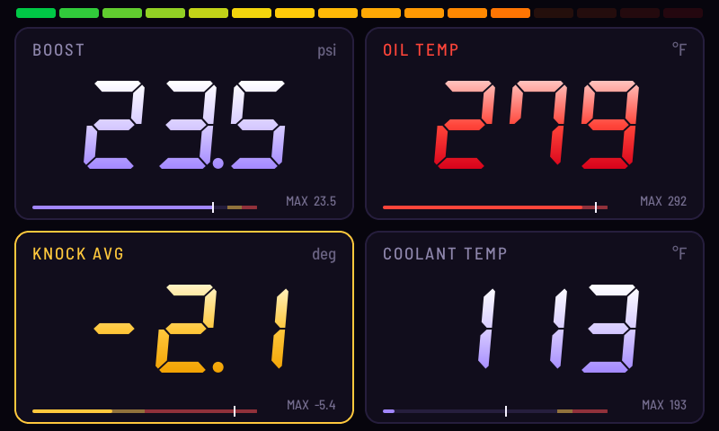
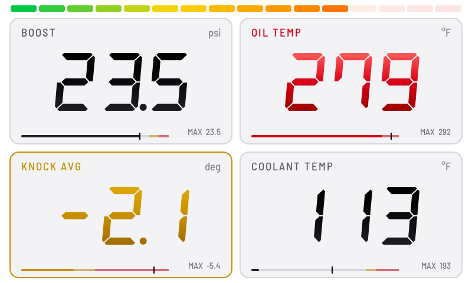
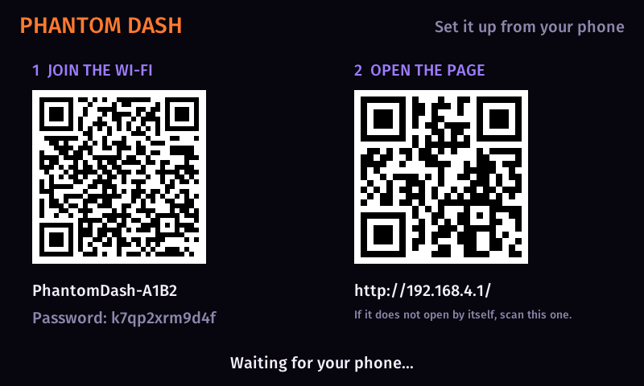
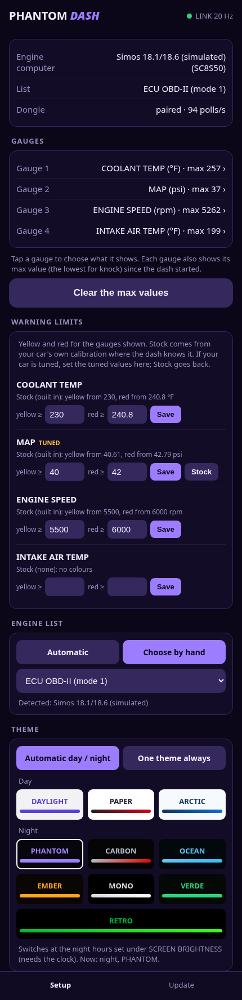
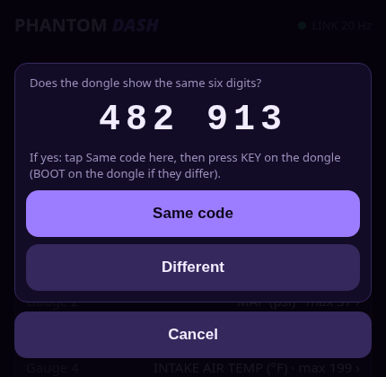

# PhantomDASH

An in-car digital dash for VAG cars. It shows live engine data from a [PhantomCAN](https://github.com/NotActuallyBlue/PhantomCAN) dongle on a 5-inch screen: big gauges and shift
lights, nothing else. **You set it up from your phone**, once or twice, sitting back in the seat instead of reaching into the dash. No app to install: the dash serves its own web page.

**Status: in development.** PhantomDASH has not been released, so features and screens can still change.

**Firmware downloads** will appear in this page's [Releases](../../releases) section: the update file (`phantomdash.bin`) and a checksum file. There is no release yet.

**Contents:** [What it does](#what-it-does) · [What you need](#what-you-need) · [Supported cars](#supported-cars) · [First start](#first-start) ·
[The phone page](#the-phone-page) · [Driving lockout](#driving-lockout) · [Updating the firmware](#updating-the-firmware) ·
[Troubleshooting](#troubleshooting) · [Safety and legal](#safety-and-legal) · [Credits and licences](#credits-and-licences)

---

## What it does

* **Four or six big gauges, or one big and three small** (by default boost, oil temperature, knock and coolant temperature, then intake air temperature and battery voltage). You choose what each gauge shows from your phone.
* **Gear indicator** (optional): the gear between the gauges, N when no forward gear is engaged.
* **Start-up sweep:** at power-on the shift lights and scales sweep once, like an instrument cluster.
* **Day and night themes:** a light theme with a white backdrop and black numbers for the day (easiest to read in direct sun), a dark theme for the night, switched automatically at the night hours (the same schedule as the brightness). Three day themes and seven night themes; or keep one theme at any time of day.
* **Your look:** six number fonts (digital, italic, condensed, wide, technical, clean), gauges on cards or a minimal layout with thin lines between them, numbers in a gradient or a solid colour, a thin scale under each number (warning zones marked, the max value as a tick), and shift lights in green-to-red or the theme's colours.
* **Shift lights:** a bar of 16 lights across the top that fills from green to red over the whole rev range, from 1,500 rpm (idle shows nothing) to 6,000 rpm, where the tachometer's red zone starts and the whole bar flashes red.
* **Warning colours:** a gauge turns yellow, then red. Stock limits come from your own car's factory calibration where the dash knows it (turbo speed, boost and manifold pressure, fuel pump, compressor temperature: yellow where the engine computer starts protecting itself, red at its hard limit), and from limits for the EA888 Gen 3 otherwise (for example coolant 110 / 116 °C, 230 / 241 °F; oil 125 / 135 °C, 257 / 275 °F). If your car is tuned, set your tune's values on the phone page; one tap goes back to stock. A gauge in the red also flashes its frame, so it catches your eye when you are not looking at it.
* **Max values:** each gauge shows the highest value since the dash started (the lowest for knock). Clear them from the phone page.
* **Brightness:** a day and a night level, set from the phone page; the night level follows the dash's clock. The screen also says why the gauges are empty: NO DONGLE, CAR OFF or APP CONNECTED.
* **Set up from your phone:** pair the dongle, choose the gauges, theme, units, the engine list, the clock, update the firmware, and load a new list of values if you are sent one (no computer needed). The dash is a live view; it does not record (the dongle is where logging happens).
* **ECU detection:** the dash reads which engine computer the car has (through the dongle) and picks the matching list of values by itself. You can still choose by hand.
* **Pure gauge view while driving:** above 10 mph the phone page refuses changes, so nobody fiddles with it on the move.

## What you need

* A **PhantomCAN dongle** in the car's OBD-II port, in Simos mode, its normal mode (see the dongle's README). The dash does not read the car itself. While a phone app (Simos.app) is connected to the dongle, the dash shows **APP CONNECTED**; its values come back a few seconds after the app disconnects.
* The dash: a 5-inch 800 x 480 ESP32-S3 display board from Waveshare running PhantomDASH, powered from the car (6 to 36 V; a fused feed is advised).
* A **phone** with a browser (any phone).

## Supported cars

PhantomDASH reads what the engine computer answers to standard diagnostic requests, through the PhantomCAN dongle. It is built for the **Simos 18** engine computers of the 2.0 and 1.8 TSI (EA888 Gen 3) engines in MQB cars.

| Engine computer | Software code the car reports | Status |
|---|---|---|
| Simos 18.1 / 18.6 | `SC8...` | **Supported.** The dash reads the engine computer's identity from the car and loads that car's factory limits. |
| Simos 18.10 | `SCG...` | **Uses the same list as the Mk7.** If a value looks wrong, choose the list by hand under **Engine list** on the phone page. |
| Simos 19 (Gen 4, Mk8 and newer) | `SCR...` and others | **Not supported yet.** The dash recognises that it is a different engine computer and leaves the list alone. Support depends on open lists for these cars becoming available. |

Other engines and cars may work with the OBD-II list (the standard emissions-related values).

**Kinds of lists.** Mode 22 lists (the engine computer's standard identifiers) are what the dash uses by default. HSL lists (the engine computer's high-speed logging, marked "(HSL)" in the list picker) need a tune with the HSL patch; the dongle supports them for the engine computer. If the engine computer refuses HSL, the phone page says so; choose a mode 22 list.

## First start

When the dash starts it shows a welcome screen with two QR codes:

1. Scan the **first code** with your phone's camera to join the dash's Wi-Fi (the network name and password are printed under it). The dash keeps its password, so your phone joins by itself next time.
2. Scan the **second code** (or open `http://192.168.4.1/`) to open the phone page. If your phone says "connected without internet" and shows nothing, tap the network's **Manage router** link (Android) or open the address in the browser.
3. The welcome screen leaves a few seconds after the page opens (or after three minutes), and **it is shown only on the first start**: once the page has been opened the dash remembers that and later starts go straight to the gauges.
4. To see the welcome screen again (the Wi-Fi name, password and page address), **reset the dash twice within a few seconds** (press RESET twice, or switch the power off and on twice). The BOOT button cannot be used for this on this board.

## The phone page

* **Status:** the engine computer the dongle found, the list in use, the dongle link.
* **Gauges:** tap a gauge to choose what it shows from the list.
* **Engine list:** automatic (the dash picks the list from the engine computer) or choose by hand.
* **Theme:** automatic day and night (choose a day theme and a night theme), or one theme always.
* **Look:** four gauges, six, or one big with three small; gauges on cards or a minimal layout; six number fonts; numbers in a gradient or one colour; the scale under each number on or off; shift lights in green to red or in the theme's colours; the gear indicator; the start-up sweep.
* **Warning limits:** for each gauge shown, the stock yellow and red limits and where they come from, and fields to set your own if your car is tuned (**Stock** goes back).
* **Screen brightness:** a day and a night level, and the night hours.
* **Units, max values:** imperial or metric; clear the max values.
* **Pairing:** disconnect any phone app from the dongle, hold **BOOT** on the dongle until its screen says **PAIR DASH** (about 4 seconds) and let go, then tap **Start pairing**. Both screens show the same six digits: tap **Same code** on the page, then press **KEY** on the dongle. If they differ, tap **Different**.
* **Clock:** it sets itself from your phone when you open the page; there is also a button.
* **Update tab:** update the firmware, or load a new list of values.

Every action shows a message at the top of the page ("Not while driving", and so on), so you always see whether it worked.

## Driving lockout

Above 10 mph the page refuses changes ("Not while driving"); only the clock is accepted. It unlocks again below 9 mph. If the speed is missing for more than 5 seconds, it unlocks so you are never locked out of a stopped car.

## Updating the firmware

You can update over Wi-Fi without any cable. The first step has to happen while your phone still has internet, because the dash's own network has none.

1. **Get the file.** On your phone, download `phantomdash.bin` from this page's [Releases](../../releases).
2. **Send the file.** Join the dash's Wi-Fi, open the phone page, go to the **Update** tab, tap **Choose the update file** and pick `phantomdash.bin`. The upload starts at once and the dash restarts by itself.

Only the PhantomDASH file is accepted; the dongle's file is refused with a message. If the new software does not start properly, the dash goes back to the previous version on its own.

### Loading a new list of values

The list of values the dash can read comes already loaded. If you are sent a new list file (`.pdv`), open the **Update** tab, tap **Choose the list file** and pick it. The dash checks it, keeps the old list until the new one is stored, and restarts with the new one. A file that is not a PhantomDASH list changes nothing.

## Troubleshooting

| Problem | Try this |
|---|---|
| The gauges show `--` and **NO DONGLE** | The dash hears nothing from the dongle. Check that it is plugged in and awake, and the link on the page; pair again if needed. |
| The gauges show `--` and **CAR OFF** | The dongle hears nothing on the car's network (ignition off). The values come back when the car wakes. |
| The gauges show `--` | The dongle is connected but the car has not answered yet, or the value is not offered by the list in use. |
| The gauges show `--` and **APP CONNECTED** | A phone app (Simos.app) is connected to the dongle. The values come back a few seconds after the app disconnects. |
| An HSL list shows nothing | The engine computer did not accept HSL (it needs a tune with the HSL patch), or the list is for the gearbox. Choose a mode 22 list. |
| The night brightness never changes | It needs the dash's clock. The clock sets itself from your phone when you open the page, but it keeps the time with the power off only if a coin cell (CR927) sits in the board's battery holder. |
| The page says "No list of values loaded" | Load the list file (`.pdv`) you were sent under **Update**, LIST OF VALUES. |
| "Not while driving" | The car is moving faster than 10 mph; slow down or stop. |
| The page does not open | Open `http://192.168.4.1/` in the browser, or use the network's **Manage router** link. |
| Pairing times out | Both sides need your confirmation within 45 seconds: **Same code** on the page, then **KEY** on the dongle. |
| The update page does not open a file picker | Open `http://192.168.4.1/` in your phone's normal browser instead of the pop-up sign-in window. |

## Safety and legal

PhantomDASH shows what the engine computer reports. It is not a substitute for the car's own warning lights and gauges, and its warning limits are not a safety system: they come from your car's own factory calibration where the dash knows it, from general limits for the engine otherwise, or from values you set yourself, so check them against what your car and its tune allow. Do not use the phone page while driving (it refuses changes above 10 mph). Use at your own risk; there is no warranty. The dash does not change anything in the car.
It does not hide or alter any fault codes or emissions data.

PhantomDASH and Ghostwerks are names of this product and its maker. Simos.app is a separate product by its own developer. PhantomDASH works beside it through the PhantomCAN dongle; it is not made, sponsored, endorsed or supported by them.

## Credits and licences

PhantomDASH itself is released under the **MIT licence** (see [LICENSE](LICENSE)), Copyright (c) 2026 Ethan Crouse (Ghostwerks). The source code is kept in a private repository; this page holds the README, the release files and the licence texts.

PhantomDASH is built on open-source work, used under the licences named in [licenses/THIRD_PARTY.md](licenses/THIRD_PARTY.md) (full texts):
LVGL (MIT), the QR code generator by Project Nayuki (MIT), stb_truetype, the Fira Sans, DSEG seven-segment, Barlow, Saira, Chakra Petch and Inter fonts (SIL Open Font License 1.1) and ESP-IDF (Apache 2.0 and others).
The dongle is a separate product; its README lists its own credits.
