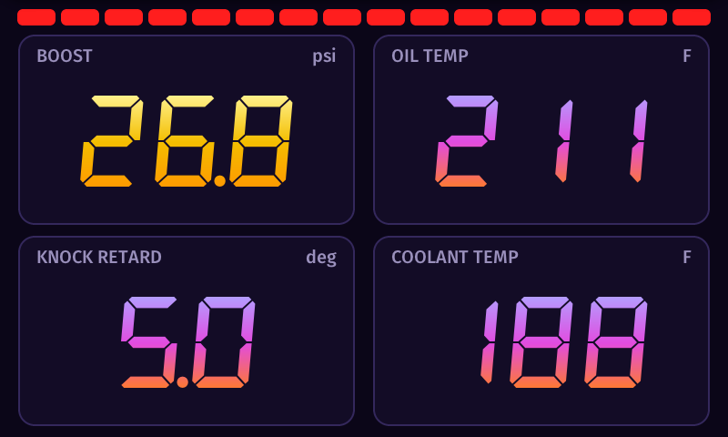
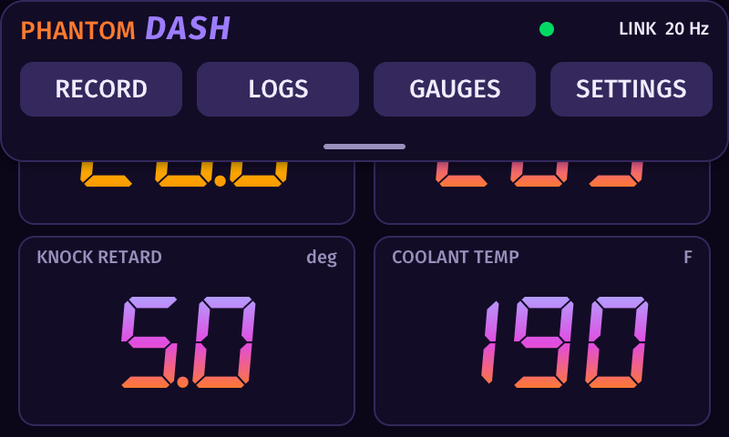
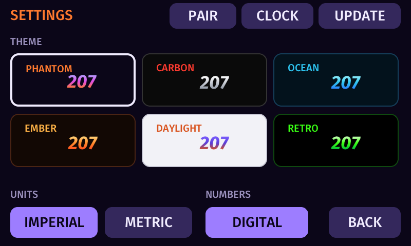
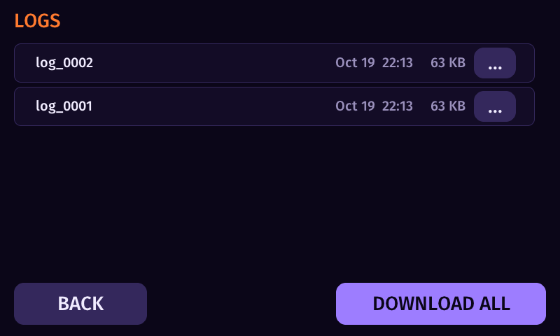
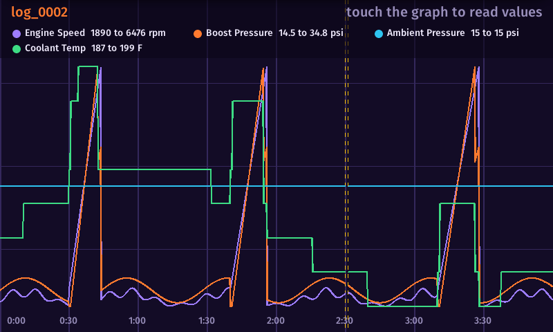
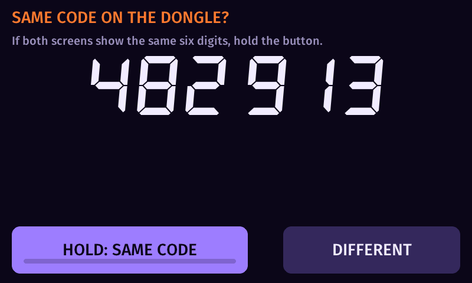
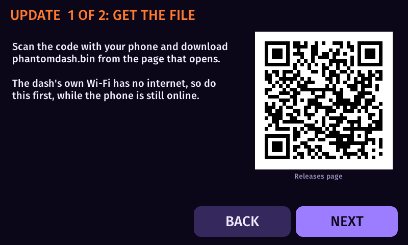

# PhantomDash

An in-car digital dash for VAG cars. It shows live engine data from a [PhantomCAN](https://github.com/NotActuallyBlue/PhantomCAN) dongle on a 5-inch touchscreen,
records your drives to an SD card, and lets you look at the logs on the dash or download them to your phone. No laptop and no app are needed.

**Status: in development.** PhantomDash has not been released. The dash software runs and has been tested in a desktop simulator and against the dongle on a test
board (including a short drive in a Golf Mk7). It has **not yet run on the production touchscreen board**, so everything below describes what the software is built
to do, not a finished product. Features and screens can still change.

**Firmware downloads** will appear in this page's [Releases](../../releases) section: the update file (`phantomdash.bin`) and a checksum file. There is no release yet.

**Contents:** [What it does](#what-it-does) · [What you need](#what-you-need) · [Supported cars](#supported-cars) · [What has been tested](#what-has-been-tested) · [First start and pairing](#first-start-and-pairing) · [The screens](#the-screens) ·
[Recording and logs](#recording-and-logs) · [Getting logs to your phone](#getting-logs-to-your-phone) · [Driving lockout](#driving-lockout) ·
[Updating the firmware](#updating-the-firmware) · [Troubleshooting](#troubleshooting) · [Safety and legal](#safety-and-legal) · [Credits and licences](#credits-and-licences)

---

## What it does

* **Four big gauges** (boost, oil temperature, knock, coolant temperature by default; you can put any value from the list on any gauge) in seven-segment or italic numbers, in six colour themes.
* **Shift lights:** a bar of 16 lights across the top that fills as the engine speed rises and turns fully red at 7,000 rpm.
* **Recording:** one button starts a log; the dash writes a log file and a spreadsheet (CSV) file side by side on the SD card.
* **Log viewer on the dash:** graph any recorded values, zoom with two fingers, double-tap to fit the whole log.
* **Wi-Fi download:** scan a QR code with your phone to join the dash's own network and download one log or all of them. Nothing to install.
* **Wi-Fi firmware update** the same way, and a **clock**: it sets itself from your phone when you open a download page, or you set it by hand.
* **ECU detection:** the dash reads which engine computer the car has (through the dongle) and picks the matching list of values by itself. You can still choose by hand.
* **Pure gauge view while driving:** above 10 mph the menus lock and only the gauges show.

## What you need

* A **PhantomCAN dongle** in the car's OBD-II port, running DASH mode (see the dongle's README). The dash does not read the car itself.
* The dash: a Waveshare ESP32-S3-Touch-LCD-5 (800 x 480) running PhantomDash, powered from the car (6 to 36 V; a fused feed is advised).
* A **microSD card** (FAT32). It holds the list of values the dash can read, your settings and your logs.
* The **list of values** (names, units, formulas and addresses per ECU software version) for your car. It comes from Tycho (Simos.app) and is copied to the card as `master.tsv`. This project does not ship lists.

## Supported cars

PhantomDash reads what the engine computer answers to standard diagnostic requests, through the PhantomCAN dongle. It is built and tested for the **Simos 18** engine computers of the 2.0 and 1.8 TSI (EA888 Gen 3) engines in MQB cars.

| Engine computer | Software code the car reports | Status |
|---|---|---|
| Simos 18.1 / 18.6 | `SC8...` | **Tested** on one car: a 2017 Golf GTI (Mk7), in a short drive on a test board. Detection by the dongle's report of this code is built but not yet seen in the car. |
| Simos 18.10 | `SCG...` | **Expected to use the same list as the Mk7; not tested.** If a value looks wrong, choose the list by hand on the GAUGES page. |
| Simos 19 (Gen 4, Mk8 and newer) | `SCR...` and others | **Not supported yet.** The dash recognises that it is a different engine computer and leaves the list alone. Support depends on open lists for these cars becoming available. |

Other engines and cars may work with the OBD-II list (the standard emissions-related values), but they are not tested.

## First start and pairing

The dash and the dongle talk over an encrypted radio link, and they have to be paired once. Nothing is typed.

1. On the dongle, put it into pairing: hold **KEY** for 2 seconds. Its screen shows a six-digit code.
2. On the dash, open the pull-down menu, then **SETTINGS**, then **PAIR**. The dash finds the dongle by itself and shows a six-digit code.
3. If both screens show **the same six digits**, **hold the button on the dash for one second** (or hold **BOOT** on the board). If they differ, tap **DIFFERENT**.

Pairing is remembered. The dash then asks the dongle which engine computer is in the car and picks the matching list of values by itself (see [Supported cars](#supported-cars)). If you choose a list by hand on the **GAUGES** page, the dash stops choosing for you.

## What has been tested

Plainly, so you know what you are getting while this is in development:

* **Tested in the desktop simulator:** every screen on this page, the log graph, the download and update pages (served by a real web server), the driving lockout.
* **Tested on a small test board** (not the final screen) against the dongle: the encrypted radio link, pairing, live data, and a short drive in a Golf Mk7 where the engine computer accepted all 47 requested values with no lost frames. The values themselves were not recorded, so the scale of the list was not checked in that drive.
* **Not yet tested:** the touchscreen board itself (the firmware for it builds, it has not been run), pairing by the board's button, the Wi-Fi firmware update from a phone, the clock from a phone, the real engine-computer detection in the car, radio range, and long drives.

## The screens

Pictures from the desktop simulator with made-up values (the dash itself has not been photographed yet).

| Gauges | Pull-down menu |
|---|---|
|  |  |

| Settings | Logs |
|---|---|
|  |  |

| Log graph | Pairing |
|---|---|
|  |  |

The main screen shows only the shift lights and the four gauges. **Swipe down from the top** for the menu: **RECORD** (it becomes STOP while recording), **GAUGES**, **LOGS**, **SETTINGS** and the link state.

* **GAUGES:** pick the ECU software, browse the values the list has for it, and tap one to put it on a gauge or add it to the log.
* **LOGS:** your recorded drives, newest first, with their dates. Tap a log to graph it. The `...` button on a row opens **DOWNLOAD** and **ERASE** for that log.
* **SETTINGS:** theme, units (imperial or metric), number style (digital or italic), and the buttons **PAIR**, **CLOCK** and **UPDATE**.
* Tapping the link state in the menu opens a small developer page with link statistics.

## Recording and logs

Tap **RECORD** in the menu to start and **STOP** to finish. The dash records the values you added to the log list (the GAUGES page) at 10 times a second.

* Each log is two files on the card: `log_0001.pdl` (the exact record of what the car sent) and `log_0001.csv` (the same values as a spreadsheet, in the units you had chosen at the time).
* A new file is started automatically after 64 MB, or if you change the values being logged. A power cut loses at most the last second.
* Recording stops cleanly when the card is nearly full. The RECORD button says `NO CARD`, `SD FULL` or `NO VALUES` when it cannot start.
* Open the **LOGS** page and tap a log to see it as a graph, full screen. Drag to move, pinch (two fingers) to zoom, double-tap to fit everything.

## Getting logs to your phone

1. Open **LOGS**. Tap **DOWNLOAD ALL**, or the `...` on one log and then **DOWNLOAD**.
2. Scan the QR code on the dash with your phone's camera. It joins the dash's Wi-Fi network (a new password each time).
3. The download page opens by itself. If your phone says "connected without internet" and shows nothing, tap the network's **Manage router** link (Android) or open `http://192.168.4.1` in the browser.
4. Tap the log you want (CSV for a spreadsheet, or the binary file), or **download all** as one ZIP.
5. Tap **DONE** on the dash. The Wi-Fi network turns off.

Or take the SD card out and read the `.csv` files on a computer.

## Driving lockout

Above 10 mph the dash shows only the gauge screen and ignores the menus. It unlocks again below 9 mph. If the speed is missing for more than 5 seconds, it unlocks so you are never locked out of a stopped car. Pairing, updates, clock and downloads are only available when parked.

## Updating the firmware

You can update over Wi-Fi without any cable. It takes two steps, and the first has to happen while your phone still has internet.

1. **Get the file.** On the dash open **SETTINGS**, **UPDATE**. Step 1 shows a QR code for this page's [Releases](../../releases). Scan it and download `phantomdash.bin` to your phone. (The dash's own network has no internet, so do this first.)
2. **Send the file.** Tap **NEXT**. Scan the new QR code to join the dash's Wi-Fi, open the page (use **Manage router** if the phone says "connected without internet"), tap **Choose the update file**, and pick `phantomdash.bin`. The upload starts at once and the dash restarts by itself.

Only the PhantomDash file is accepted; the dongle's file is refused with a message. If the new software does not start properly, the dash goes back to the previous version on its own.

## Troubleshooting

| Problem | Try this |
|---|---|
| The gauges show `--` | The dongle is not connected or has no data. Check the link state in the menu; pair again if needed. |
| RECORD says `NO CARD` | Put in a FAT32 microSD card. |
| RECORD says `NO VALUES` | The card has no `master.tsv`, or nothing is on the log list. Add values on the GAUGES page. |
| The menu does not open | The car is moving faster than 10 mph; slow down or stop. |
| The download page does not open | Open `http://192.168.4.1` in the browser, or use the network's **Manage router** link. |
| The update page does not open a file picker | Open `http://192.168.4.1` in your phone's normal browser instead of the pop-up sign-in window. |

## Safety and legal

PhantomDash shows what the engine computer reports. It is not a substitute for the car's own warning lights and gauges, and its warning limits are defaults, not
manufacturer limits. Do not operate the touchscreen while driving. Use at your own risk; there is no warranty. The dash does not change anything in the car.
It does not hide or alter any fault codes or emissions data.

## Credits and licences

PhantomDash itself is released under the **MIT licence** (see [LICENSE](LICENSE)), Copyright (c) 2026 Ethan Crouse (Ghostwerks). The source code is kept in a private repository; this page holds the README, the release files and the licence texts.

PhantomDash is built on open-source work, used under the licences named in [licenses/THIRD_PARTY.md](licenses/THIRD_PARTY.md) (full texts):
LVGL (MIT), the QR code generator by Project Nayuki (MIT), stb_truetype, the Fira Sans font (SIL Open Font License 1.1), the DSEG seven-segment font (SIL Open Font License 1.1) and ESP-IDF (Apache 2.0 and others).
The value lists and the Simos.app ecosystem are the work of Tycho; the dongle is built on the work of Brian Ledbetter and Switchleg1 (see the PhantomCAN README).
